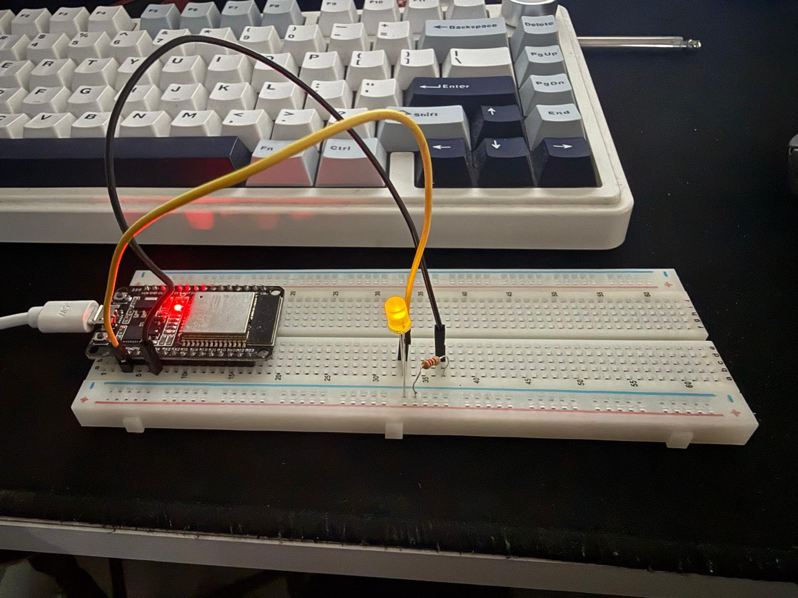
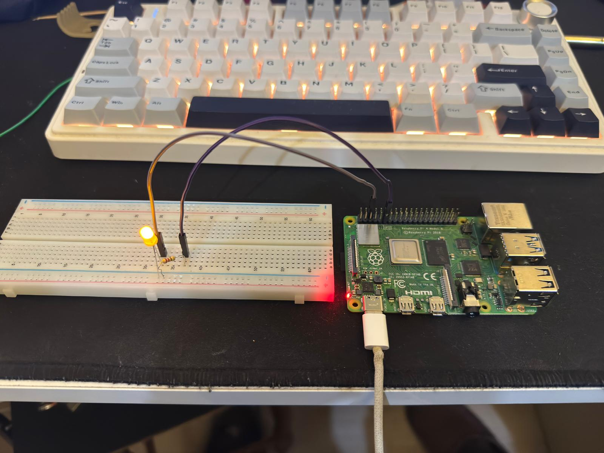

# Laboratuvar 1 — ESP32 ve Raspberry Pi ile GPIO Kontrolü


İleri Gömülü Sistemler dersi kapsamında iki platformda harici LED

kontrolü, yazılımsal GPIO hız hesabı ve ARM64 çapraz derleme çalışması.


## Kullanılan donanım ve yazılım


- Standart ESP32 geliştirme kartı

- Raspberry Pi 4 Model B, 4 GB RAM

- LED, seri direnç, breadboard ve jumper kablolar

- VS Code ve ESP-IDF v6.1.0

- Raspberry Pi OS 64-bit ve libgpiod v2.2.1

- Windows üzerinde WSL Ubuntu

- aarch64-linux-gnu-gcc 15.2.0


Ders örneği ESP32-S3 için hazırlanmıştır. Bu çalışmada standart

ESP32 kullanılmış, register tanımları hedefe uygun ESP-IDF

başlık dosyalarından alınmıştır.


## Bağlantılar


| Platform | LED kontrol pini | Bağlantı |
|---|---|---|
| ESP32 | GPIO4 | GPIO4 → seri direnç → LED anot; LED katot → GND |
| Raspberry Pi 4 | GPIO17, fiziksel pin 11 | GPIO17 → seri direnç → LED anot; LED katot → GND, fiziksel pin 6 |


## Yapılan çalışmalar


1\. ESP-IDF hello_world örneği derlendi ve karta yüklendi.

2\. size-components çıktısı incelendi.

3\. ESP32'de W1TS/W1TC registerlarıyla LED kontrol edildi.

4\. Raspberry Pi'de libgpiod C arayüzüyle LED kontrol edildi.

5\. Her platformda 100.000 tam periyot için geçen süre ölçüldü.

6\. Raspberry Pi programı laptopta ARM64 için çapraz derlendi,

&#x20;  karta aktarıldı ve çalıştırılarak doğrulandı.


## Sonuçlar


| Platform / derleme | Periyot sayısı | Süre (s) | Ortalama frekans (Hz) |
|---|---:|---:|---:|
| ESP32 / ESP-IDF | 100000 | 0.013758 | 7268498.33 |
| Raspberry Pi / yerel derleme | 100000 | 0.252429 | 396151.48 |
| Raspberry Pi / çapraz derleme | 100000 | 0.252068 | 396718.53 |


Frekans, tam periyot sayısının geçen süreye bölünmesiyle hesaplanmıştır.


Sonuçlar yazılımsal süre ölçümüne dayanır. Lojik analizör

kullanılmamış; fiziksel dalga şekli ve periyot değişkenliği

ölçülmemiştir. Değerler donanımın mutlak maksimum frekansı

olarak yorumlanmamalıdır.


ESP32 doğrudan register erişimi, Raspberry Pi ise Linux ve

libgpiod üzerinden çalışır. Bu nedenle sonuçlar işlemcilerin

genel performans karşılaştırması değildir.


## Çalıştırma


### ESP32


ESP-IDF terminalinde lab1_gpio klasöründen:


```bash

idf.py build

idf.py -p COM7 flash monitor

```


COM7 yerine kartın bağlı olduğu port kullanılmalıdır.


### Raspberry Pi — yerel derleme


raspberry_pi klasörünün içeriği Raspberry Pi'ye kopyalandıktan sonra:


```bash

gcc -Wall -Wextra -O2 led.c -o led -lgpiod

./led

```


Program LED'i beş kez yanıp söndürür, ardından hız hesabını yapar.


## Dosyalar


- hello_world/: İlk uygulama ve bileşenlere göre bellek kullanım çıktısı

- lab1_gpio/: ESP32 kaynak kodu ve derleme ayarları

- raspberry_pi/: Raspberry Pi C kodu ve test çıktıları

- images/: Devre fotoğrafları ve terminal ekran görüntüleri


## Devre fotoğrafları


### ESP32




### Raspberry Pi




